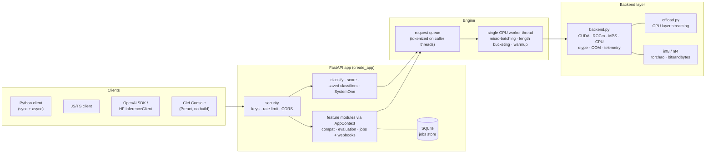

<div align="center">

# clef

**Calibrated, one-pass classification with a 9B multimodal model, served from your own GPU.**

clef runs Cloudflare's [clef-flash](https://huggingface.co/Cloudflare/clef-flash) decision model locally behind a FastAPI server. You get an OpenAI-compatible API, an evaluation toolkit, async jobs, Python and JavaScript clients, and a web console.

[](LICENSE)
[](https://miguelcarrascob.github.io/clef/)


[Quick start](#quick-start) · [Usage](#usage) · [How it works](#how-it-works) · [Performance](#performance) ·
[Install](#installation) · [Docs](https://miguelcarrascob.github.io/clef/)


</div>

---

## Why clef

Using a generative LLM as a classifier means writing a prompt, parsing free text and hoping the confidence it states means something. clef-flash (a Qwen3.5-9B backbone with a joint schema head) does something different. It reads an input (**text, JSON, images or video**) together with a set of options and returns a **calibrated probability for every option in one forward pass**. There is no generated text, so there is nothing to parse.

```python
from clef_client import ClefClient

ClefClient().classify("Checkout is down", ["billing", "technical"])
# -> label='technical' confidence=0.96 scores={'billing': 0.04, 'technical': 0.96}
```

- 🎯 **One call returns every probability:** single-label, multi-label, ordinal scores and typed multi-question batches.
- 🖼️ **Multimodal input:** text, JSON, images and video in the same request.
- 🔌 **Works with existing clients:** the official OpenAI SDK (structured outputs) and Hugging Face zero-shot clients run against your own machine.
- 📏 **Measures quality on your data:** accuracy, F1, a confusion matrix and calibration (ECE, Brier), plus a coverage-vs-accuracy curve for choosing an auto-route threshold.
- ⏱️ **Async jobs and webhooks:** up to 100,000 rows per job, persisted in SQLite and resumable after a restart, with signed callbacks guarded against SSRF.
- 💻 **Runs on the hardware you have:** NVIDIA, AMD (ROCm, also under WSL2), Apple Silicon and CPU. A 24 GB card runs it as is. **16, 12 and 8 GB GPUs** work through CPU layer streaming or int8, and the cost of each option is measured.
- 🧰 **Comes with tooling:** a `clef` CLI (`serve`, `doctor`, `download`, `bench`), typed sync and async Python clients, a JS/TS client with no dependencies, an OpenAPI schema, Docker images and service files.
- 🔒 **Local by default:** binds to loopback only, with named API keys, per-key rate limits, SSRF guards and input caps for LAN use.

> [!NOTE]
> clef is an independent project. It is not affiliated with or endorsed by Cloudflare; it runs their openly released clef-flash model.

## Quick start

> [!IMPORTANT]
> A **24 GB GPU** or a **Mac with 32 GB+ unified memory** runs clef as is. For 16, 12 or 8 GB GPUs, see [hardware requirements](#hardware-requirements). The first download needs about 40 GB of free disk.

```bash
uv tool install "clef-local[server,cuda] @ git+https://github.com/MiguelCarrascoB/clef" --torch-backend=auto
clef doctor      # checks the backend, memory and disk
clef download    # one-time, ~19 GB, pinned and resumable
clef serve       # then open http://127.0.0.1:8910/
```

Swap the `cuda` extra for `rocm`, `mps` or `cpu`. clef is not on PyPI yet; [Installation](#installation) covers each platform.

## Usage

### Classify, score, save a classifier

```python
from clef_client import ClefClient

c = ClefClient("http://127.0.0.1:8910")
c.classify("Refund me, the app also crashes", ["billing", "technical", "feature"], multi_label=True).labels
c.classify_many(["...", "..."], ["billing", "technical"])
c.score("Server has been down for two hours", ["low", "medium", "high"]).score
c.classifier("support-triage").classify("My invoice is wrong")   # labels + instructions stored server-side
```

```bash
curl -s http://127.0.0.1:8910/v1/classify -H 'Content-Type: application/json' \
  -d '{"input": "Checkout is down", "labels": ["billing", "technical"]}'
```

### With the OpenAI SDK (structured outputs)

Describe the decision as a JSON schema. Enums become choices, booleans become yes/no questions and integer scales become scores. Every probability is returned in `logprobs` and in a `clef` field.

```python
from openai import OpenAI

client = OpenAI(base_url="http://127.0.0.1:8910/v1", api_key="not-needed")
schema = {"type": "object", "properties": {
    "team": {"type": "string", "enum": ["billing", "technical", "account"]},
    "outage": {"type": "boolean"}}}
r = client.chat.completions.create(
    model="clef-flash",
    messages=[{"role": "user", "content": "Checkout is down, orders blocked"}],
    response_format={"type": "json_schema", "json_schema": {"name": "triage", "schema": schema}},
)
print(r.choices[0].message.content)  # {"team": "technical", "outage": true}
```

`huggingface_hub`'s `InferenceClient.zero_shot_classification` also works (`POST /hf/models/{id}`). LangChain is untested.

### Evaluate before you automate

Send labelled rows to get accuracy, per-label precision / recall / F1, a confusion matrix, a reliability diagram (ECE, Brier) and a coverage-vs-accuracy curve. The console's **Evaluate** tab does the same from a CSV file.

On the bundled 47-ticket sample ([`examples/tickets_labelled.csv`](examples/tickets_labelled.csv)), clef scored **accuracy 0.87 and ECE 0.04** on the RX 7900 XTX. That is a small sample, so run the evaluation on your own data.

### Large workloads

```python
with ClefClient() as clef:
    job = clef.classify_job(texts, ["billing", "technical", "account"])
    job = clef.wait_job(job.id, on_progress=lambda j: print(j.status, j.done, j.total))
    clef.save_job_results(job.id, "results.csv", format="csv")
```

Jobs survive restarts and share the GPU fairly with interactive calls. Results can be paged or streamed as JSON, NDJSON or CSV. Webhooks are off until `CLEF_WEBHOOK_ALLOW` lists the receivers.

<details>
<summary><b>All endpoints</b></summary>

| Endpoint | Use it for |
| --- | --- |
| `POST /v1/classify`, `/v1/classify/batch`, `/v1/score` | classification and ordinal scores |
| `PUT /v1/classifiers/{name}` | saved classifiers |
| `POST /v1/systemone`, `/v1/batch` | the native typed-question API (`choice` / `score` / `noul`), images and video |
| `GET /v1/models`, `POST /v1/chat/completions` | OpenAI-compatible structured outputs (also SSE streaming) |
| `POST /hf/models/{id}` | Hugging Face zero-shot |
| `POST /v1/evaluate`, `/v1/evaluate/metrics` | evaluation metrics |
| `/v1/jobs…` | async jobs (create, list, get, results, cancel, delete) |
| `GET /health`, `/v1/stats`, `/v1/log`, `/v1/events` | status and observability (SSE) |

Full schema: [openapi.json](openapi.json), or `/docs` on a running server.

</details>

## How it works



Design points:

- **Only one thread ever touches the GPU.** Requests are tokenized in a thread pool, queued, and resolved through futures by the engine worker. That worker micro-batches text records by length bucket and pads to a multiple of 64. On ROCm this is faster than raw lengths, because hipBLASLt picks better GEMM tiles for aligned shapes.
- **All device-specific code is in `backend.py`:** detection, dtype rules, OOM handling, memory caps, pinned host copies and telemetry. Everything else is backend-agnostic and unit-tested on CPU with mocked backends.
- **CPU offload streams decoder layers in for each forward.** `offload.py` plans which layers stay on the host and copies them in asynchronously. Probabilities stay identical to the full-GPU run; only latency changes.
- **Features plug in through `AppContext`.** The OpenAI/HF compatibility routes, evaluation and jobs are modules that receive the engine, stats and auth dependencies through one interface.

Details: [docs/ARCHITECTURE.md](docs/ARCHITECTURE.md) and [docs/performance.md](docs/performance.md).

## Performance

Measured on an AMD RX 7900 XTX (ROCm 7.2, WSL2, bf16). This is the only GPU the project has run on so far. Records are about 330 tokens; 100 requests per level with `clef bench` ([details](docs/hardware-results.md)).

| | v3 |
| --- | --- |
| Single record p50 / p95 | 149.0 / 159.2 ms |
| Throughput, concurrency 1 | 6.6-6.7 req/s |
| Throughput, concurrency 16 (micro-batching) | 8.8-8.9 req/s |
| Peak VRAM | ~19.5 GB |

Profiling shows the model is **compute-bound**: GEMMs take about 83% of GPU kernel time, and roughly half of a single-record forward is host overhead. NVIDIA, Apple Silicon and CPU numbers are still pending.

### Hardware requirements

| You have | Use | Cost (measured on the RX 7900 XTX) |
| --- | --- | --- |
| 24 GB GPU, 32 GB+ Mac | nothing | none |
| 16 GB GPU | `CLEF_OFFLOAD=cpu CLEF_MAX_DEVICE_MEMORY_GB=15` | identical probabilities; p50 152 to 175 ms; ~6 GB host RAM |
| 12 GB GPU | `CLEF_QUANT=int8 CLEF_OFFLOAD=cpu` | p50 ~206 ms; mean probability error 0.006, 2 of 399 top choices flipped |
| 12 GB GPU, lossless | `CLEF_OFFLOAD=cpu CLEF_MAX_DEVICE_MEMORY_GB=11` | identical probabilities; p50 343 ms; ~11 GB host RAM |
| 8 GB GPU | `CLEF_OFFLOAD=cpu CLEF_MAX_DEVICE_MEMORY_GB=7` | identical probabilities; p50 540 ms; ~15 GB host RAM |
| 24 GB Mac | `CLEF_QUANT=int8` | ~12 GB; **not validated on Apple Silicon** |
| CPU | ~40 GB RAM | works, but slow; for development and tests |

`CLEF_QUANT=nf4` also loads, but it flipped about 9% of top choices in our set, so it is not recommended. `clef doctor` reads your memory and prints the matching setting.

### Platform support

| Platform | Backend | Status |
| --- | --- | --- |
| Windows + WSL2, AMD RX 7900 XTX | ROCm 7.2 | ✅ verified (all tests and benchmarks) |
| Any OS, no GPU | CPU | ✅ unit-tested on Ubuntu, macOS and Windows |
| Ubuntu / WSL2, NVIDIA | CUDA | ⚠️ untested on hardware (code paths unit-tested with mocks) |
| macOS, Apple Silicon | MPS | ⚠️ untested on hardware |

**Have an NVIDIA card or a Mac?** Running [docs/hardware-validation.md](docs/hardware-validation.md) and contributing the results is the most useful help right now.

## Installation

Every path ends the same way: `clef download` once, then `clef serve`, then open <http://127.0.0.1:8910/>.

<details><summary><b>🐧 Ubuntu + NVIDIA</b></summary>

```bash
git clone https://github.com/MiguelCarrascoB/clef && cd clef
uv venv --python 3.12 && source .venv/bin/activate
uv pip install -r requirements/cuda.txt && uv pip install -e ".[server]"
clef doctor && clef download && clef serve
```
</details>

<details><summary><b>🍎 macOS (Apple Silicon)</b></summary>

```bash
git clone https://github.com/MiguelCarrascoB/clef && cd clef
uv venv --python 3.12 && source .venv/bin/activate
uv pip install -r requirements/macos.txt && uv pip install -e ".[server]"
clef doctor && clef download && clef serve
```

Requires macOS 14+ for bf16. `PYTORCH_ENABLE_MPS_FALLBACK=1` is set automatically.
</details>

<details><summary><b>🪟 Windows + WSL2, AMD ROCm (the verified setup)</b></summary>

On Windows you need a current Adrenalin driver, WSL2 with Ubuntu, and a `.wslconfig` based on `deploy/wslconfig.sample` (`memory=26GB` on a 32 GB host). Then, inside WSL:

```bash
sudo bash scripts/wsl_setup_root.sh      # ROCm + librocdxg (once)
bash scripts/wsl_setup_user.sh           # venv, model download
```

Then from PowerShell, run `.\clef.ps1 start`, `.\clef.ps1 open` and `.\clef.ps1 stop`. See [troubleshooting](docs/troubleshooting.md#rocm-under-wsl2).
</details>

<details><summary><b>🐳 Docker</b></summary>

```bash
docker compose --profile cuda up -d     # or --profile rocm (Linux host)
```

Ports are published on `127.0.0.1`. For LAN access, set `CLEF_BIND=0.0.0.0` together with `CLEF_API_KEYS`.
</details>

<details><summary><b>🖥️ CPU only</b></summary>

```bash
git clone https://github.com/MiguelCarrascoB/clef && cd clef
uv venv --python 3.12 && source .venv/bin/activate
uv pip install -r requirements/cpu.txt && uv pip install -e ".[server]"
clef download && CLEF_DEVICE=cpu clef serve
```
</details>

Configuration is done entirely through `CLEF_*` environment variables, and the CLI flags set the same variables: see [docs/configuration.md](docs/configuration.md). For remote access, see [docs/remote-access.md](docs/remote-access.md) and the threat model in [SECURITY.md](SECURITY.md).

## Development

```bash
uv pip install -r requirements/cpu.txt && uv pip install -e ".[server,dev]"
pytest tests/unit && ruff check . && ruff format --check .   # CPU only, never loads the weights
```

The repository has 500+ unit tests covering the API, engine, offload planning, evaluation metrics, jobs, webhooks, security and clients. All of them run on CPU against mocked backends. See [CONTRIBUTING.md](CONTRIBUTING.md).

## Roadmap

- [ ] Validate on NVIDIA and Apple Silicon hardware, then publish the numbers
- [ ] Publish to PyPI (`clef-local`)
- [ ] Remove the device sync in SDPA masking to unblock graph capture / `torch.compile`, since about 50% of a single-record forward is host overhead
- [ ] Quantization accuracy table on CUDA (int8 / nf4 vs bf16)
- [ ] Test the LangChain integration

## License

Apache-2.0, see [LICENSE](LICENSE). The model is Cloudflare's [clef-flash](https://huggingface.co/Cloudflare/clef-flash), also Apache-2.0 (base model Qwen/Qwen3.5-9B). The console vendors Preact, htm and uPlot; see [THIRD_PARTY_NOTICES](src/clef_server/static/vendor/THIRD_PARTY_NOTICES.md).

---

<details>
<summary><b>🇪🇸 Español</b></summary>

**clef** sirve en local, en tu propia GPU, el modelo de decisión **clef-flash** de Cloudflare (9B, multimodal). En una sola pasada devuelve una **probabilidad calibrada para cada opción**: no genera texto, así que no hay nada que parsear.

- **API compatible con OpenAI** (*structured outputs*) y con *zero-shot* de Hugging Face, además de clientes en Python (síncrono y asíncrono) y en JS/TS.
- **Evaluación con tus propios datos:** *accuracy*, F1, matriz de confusión, calibración (ECE, Brier) y una curva cobertura-precisión para elegir el umbral de automatización. En la muestra incluida, de 47 tickets, obtuvo *accuracy* 0.87 y ECE 0.04.
- **Trabajos asíncronos** de hasta 100 000 filas, guardados en SQLite y reanudables, con *webhooks* firmados.
- **Funciona en NVIDIA, AMD (ROCm/WSL2), Apple Silicon y CPU.** En GPUs de 16, 12 u 8 GB funciona con *offload* a CPU o int8, y el coste de cada opción está medido.
- **Rendimiento medido en una RX 7900 XTX:** p50 de 149 ms por registro y hasta 8.9 req/s con *micro-batching*.
- **Seguro por defecto:** solo escucha en *loopback*, con claves API con nombre, límite de peticiones y protección contra SSRF.

Inicio rápido:

```bash
uv tool install "clef-local[server,cuda] @ git+https://github.com/MiguelCarrascoB/clef" --torch-backend=auto
clef doctor && clef download && clef serve   # http://127.0.0.1:8910/
```

Proyecto independiente, sin afiliación con Cloudflare. Documentación: <https://miguelcarrascob.github.io/clef/>

</details>
